# Diagrama de clases — Fase 0

GitHub dibuja este diagrama automáticamente. Para exportarlo a PDF o PNG,
copien el bloque `mermaid` en [mermaid.live](https://mermaid.live).

```mermaid
classDiagram
    direction TB

    class Organismo {
        <<abstracta>>
        +PARAMETROS: dict$
        +SIMBOLO: str$
        +ORDEN_EN_TURNO: int$
        #_fila: int
        #_columna: int
        #_energia: int
        #_edad: int
        #_vivo: bool
        +fila: int
        +columna: int
        +posicion: tuple
        +nombre: str
        +energia: int
        +edad: int
        +vivo: bool
        +energia_max: int
        +umbral_reproduccion: int
        +energia_al_nacer: int
        +mover_a(fila, columna)
        +ganar_energia(cantidad)
        +perder_energia(cantidad)
        +pagar_metabolismo()
        +envejecer()
        +supera_edad_maxima() bool
        +puede_reproducirse() bool
        +pagar_reproduccion()
        +morir()
        +a_diccionario() dict
        #_preparar_cria(mundo) tuple
        #_registrar_nacimiento(mundo, cria)
        #_comer(mundo, presa)
        #_moverse_al_azar(mundo)
        #_pagar_metabolismo_o_morir(mundo) bool
        +actuar(mundo)*
        +reproducirse(mundo)*
    }

    class Planta {
        +SIMBOLO = "P"$
        +ORDEN_EN_TURNO = 1$
        +actuar(mundo)
        +reproducirse(mundo)
    }

    class Herbivoro {
        +SIMBOLO = "H"$
        +ORDEN_EN_TURNO = 2$
        +actuar(mundo)
        +reproducirse(mundo)
    }

    class Carnivoro {
        +SIMBOLO = "C"$
        +ORDEN_EN_TURNO = 3$
        +actuar(mundo)
        +reproducirse(mundo)
    }

    class Mundo {
        +DIRECCIONES: list$
        #_filas: int
        #_columnas: int
        #_grid: list~list~
        #_organismos: list~Organismo~
        #_turno: int
        #_semilla: int
        #_azar: Generator
        #_bitacora: list~str~
        +filas: int
        +columnas: int
        +turno: int
        +semilla: int
        +organismos: list~Organismo~
        +bitacora: list~str~
        +esta_dentro(fila, columna) bool
        +celda(fila, columna) Organismo
        +vecinas(fila, columna) list
        +vecinas_libres(fila, columna) list
        +celdas_libres() list
        +elegir(opciones)
        +registrar(texto)
        +poblacion() dict
        +colocar(organismo)
        +poblar_aleatorio(poblacion_inicial)
        +mover(organismo, fila, columna)
        +retirar(organismo)
        +ejecutar_turno()
        +a_diccionario() dict
        +desde_diccionario(datos, especies)$ Mundo
        #_validar_destino(fila, columna)
    }

    Organismo <|-- Planta
    Organismo <|-- Herbivoro
    Organismo <|-- Carnivoro
    Mundo "1" o-- "0..*" Organismo : contiene
    Herbivoro ..> Planta : come
    Carnivoro ..> Herbivoro : come
```

## Cómo leerlo

| Símbolo | Significado |
|---|---|
| `#` | atributo protegido (`self._atributo`) |
| `+` | público (métodos y `@property`) |
| «abstracta» | clase que no se instancia |
| método en *cursiva* | método abstracto: cada subclase lo sobrescribe |
| subrayado | atributo de clase (compartido por todos los objetos) |
| triángulo hueco | herencia |
| rombo hueco | `Mundo` **contiene** la lista de organismos (no hereda de `Organismo`) |
| flecha punteada | dependencia: quién come a quién |

## Notas

- `energia`, `edad` y `vivo` son de solo lectura: se cambian únicamente con
  `ganar_energia()`, `perder_energia()`, `envejecer()` y `morir()`.
- `fila` y `columna` tienen setter que valida (lanza `ValueError`).
- Los módulos `busqueda.py`, `recursividad.py` y `persistencia.py` son funciones,
  no clases, por eso no aparecen en el diagrama.
